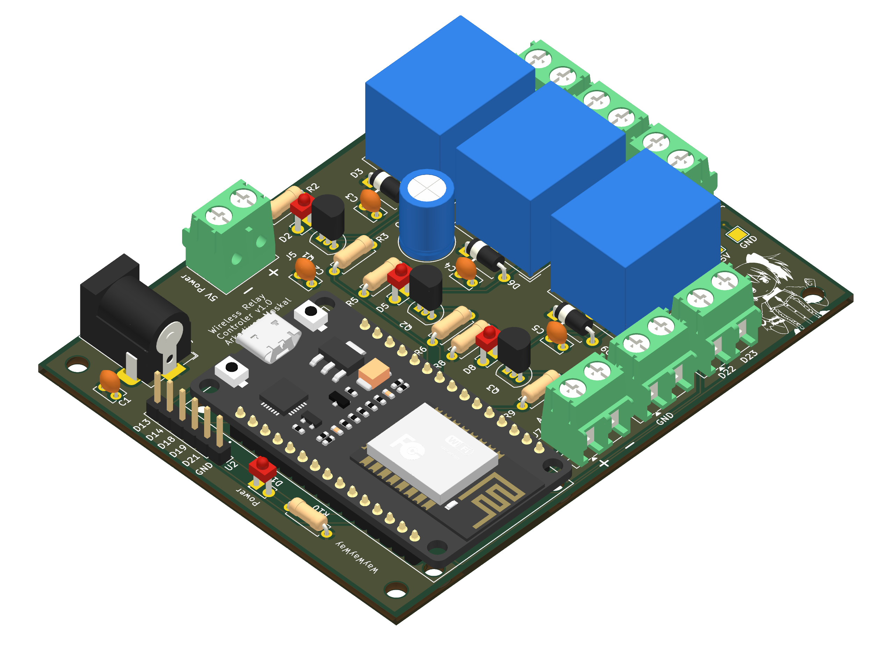
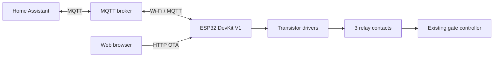
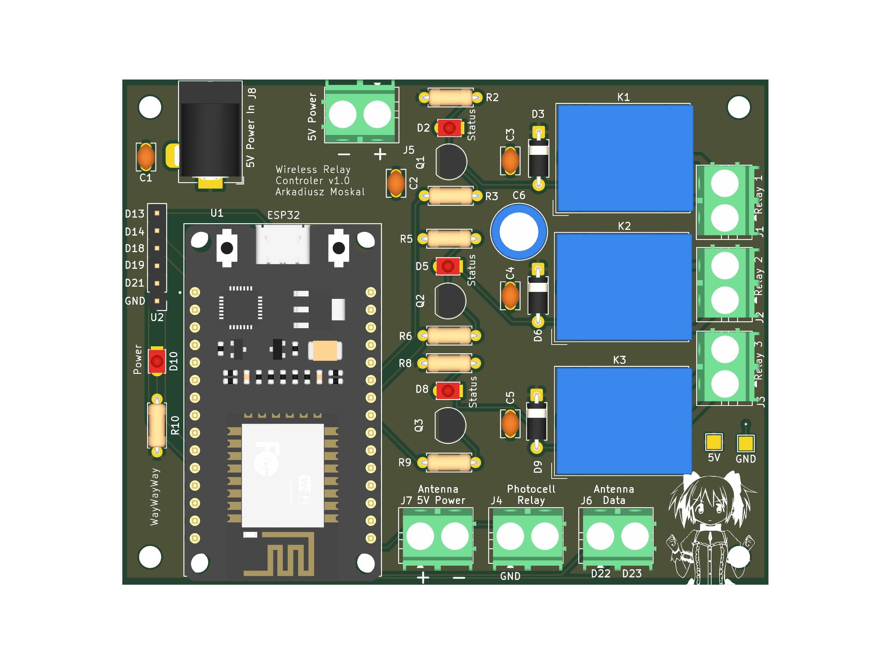
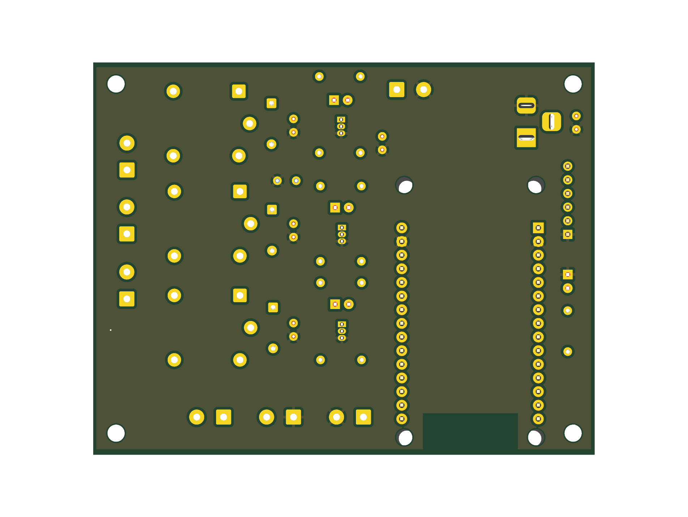

# Wireless Gate Controller

> **Note on authorship:** Large parts of the firmware source code and this initial README were generated with ChatGPT. All hardware design, including the schematic and PCB layout, was done by me.

[](https://github.com/Crekk/WirelessGateController/actions/workflows/firmware.yml)

An ESP32-based Wi-Fi controller for garage doors and gates, featuring a custom PCB, three relay outputs, MQTT communication, and native Home Assistant MQTT discovery.

The controller is designed to retrofit an existing gate automation system by emulating its **Up**, **Stop**, and **Down** push buttons, rather than replacing the motor controller itself.



**Hardware:** revision 1.0 · **Firmware:** version 1.0.2 · **Status:** manufactured prototype, hardware validation pending

## Features

- Three independently controlled, normally open relay outputs with nominal 500 ms pulses.
- Wi-Fi and MQTT integration with Home Assistant automatic device and button discovery.
- MQTT availability reporting, periodic diagnostics and on-demand status requests.
- Automatic Wi-Fi and MQTT reconnection, with recovery reboots after prolonged connectivity failures.
- Periodic gateway reachability checks.
- Password-protected web interface for over-the-air (OTA) firmware updates.
- Static IPv4 configuration and local mDNS hostname.
- Custom two-layer, through-hole PCB designed in KiCad and manufactured by PCBWay.
- Automated firmware compilation with GitHub Actions.

## System overview



Home Assistant sends commands to the ESP32 through an MQTT broker. The ESP32 briefly energizes the corresponding relay, closing its normally open contacts to emulate a button press. The existing gate controller remains responsible for motor operation, travel limits, and safety functions.

## Hardware

| Top view | Bottom view |
| :---: | :---: |
|  |  |

### Specifications

| Parameter | Specification |
| --- | --- |
| PCB revision | 1.0 |
| PCB dimensions | 93.25 × 73 mm |
| PCB layers | 2 |
| Microcontroller | ESP32 DevKit V1 (30-pin module) |
| Power input | Regulated 5 V DC, screw terminal or barrel jack |
| Relays | 3 × Hongfa JQC-3FF-005-1Z, 5 V SPDT |
| Relay drivers | 3 × BC337 NPN transistors, active HIGH |
| Flyback protection | 3 × 1N5819 Schottky diodes |
| Relay outputs | Normally open, potential-free contacts |
| Terminal pitch | 5.00 mm |
| Assembly | Through-hole components |
| Wireless interface | 2.4 GHz Wi-Fi |
| Design software | KiCad 10 (current project format) |
| PCB manufacturer | PCBWay |

### Relay mapping

| Function | ESP32 GPIO | Relay | Output connector | MQTT command topic |
| --- | ---: | --- | --- | --- |
| Up | 27 | K1 | J1 | `garage/relay1` |
| Stop | 26 | K2 | J2 | `garage/relay2` |
| Down | 25 | K3 | J3 | `garage/relay3` |

Each relay is driven by an active-HIGH transistor circuit. The firmware energizes the selected relay for a nominal 500 ms and releases it automatically. All three outputs are initialized to their inactive state during firmware setup.

### Additional connectors

| Reference | Purpose |
| --- | --- |
| J4 | Photocell connection (hardware provision) |
| J5 | 5 V DC power input |
| J6 | Antenna data connection |
| J7 | Antenna 5 V supply |
| J8 | DC barrel jack |
| U2 | Six-pin expansion header |
| TP1 / TP2 | 5 V / GND test points |

The photocell and antenna connections are hardware provisions; the current firmware does not implement their functionality.

### Design files and manufacturing

- [KiCad project](hardware/WirelessGateController.kicad_pro)
- [PCB layout](hardware/WirelessGateController.kicad_pcb)
- [Schematic source](hardware/WirelessGateController.kicad_sch)
- [Schematic PDF](docs/schematic.pdf)
- [Original PCBWay manufacturing archive](manufacturing/v1.0/PCBWay.zip)
- [Bill of materials](manufacturing/v1.0/files/PCBWay_bom.csv)
- [Extracted Gerbers, drill files, placement data and netlist](manufacturing/v1.0/files/)

Custom KiCad symbols, footprints and the ESP32 STEP model are included under `hardware/libraries/`. Install the standard KiCad 10 libraries and 3D models to display the complete project.

The PCB renders use visually similar standard KiCad models for the relays and screw terminals where the original component models are unavailable. These substitutions affect visualization only, not the PCB footprints or bill of materials.

The manufacturing archive preserves the original files submitted for revision 1.0 production. It is not a regenerated export of the current KiCad project.

## Firmware

The firmware is written in C++ using the Arduino framework and built with PlatformIO.

| Dependency | Version |
| --- | --- |
| PlatformIO Core (CI) | 6.2.0 |
| Espressif32 platform | 8.0.0 |
| Arduino ESP32 core (verified build) | 3.3.12 |
| PubSubClient | 2.8.0 |
| PlatformIO board | `esp32dev` |

### Build and flash

Install [PlatformIO Core](https://docs.platformio.org/en/latest/core/installation/index.html) or the PlatformIO IDE extension for Visual Studio Code.

Clone the repository and prepare your local configuration:

```sh
git clone https://github.com/Crekk/WirelessGateController.git
cd WirelessGateController/firmware
cp include/secrets.example.h include/secrets.h
```

Edit `include/secrets.h` and configure:

- Wi-Fi SSID and password.
- Static IP address, subnet, gateway and DNS server.
- MQTT broker address, port and credentials.
- OTA web interface username and password.

The example configuration is provided in [secrets.example.h](firmware/include/secrets.example.h). Your actual `secrets.h` is excluded from version control.

Build the firmware:

```sh
pio run
```

Connect the ESP32 via USB and upload:

```sh
pio run -t upload
```

Monitor serial output at 115200 baud:

```sh
pio device monitor
```

The firmware binary is generated at `.pio/build/esp32dev/firmware.bin` within the `firmware/` directory.

### Home Assistant integration

With Home Assistant's MQTT integration and the controller configured to use the same broker, the firmware publishes discovery configurations for a device named **Garage Controller** with three button entities:

- Up
- Stop
- Down

The discovery messages are retained by the broker, while button commands are sent without the retain flag. The device reports its availability using an MQTT Last Will and Testament message.

No custom Home Assistant component is required. The discovery behavior has been implemented in firmware; integration testing on the custom PCB is still pending.

### MQTT interface

| Topic | Direction | Purpose |
| --- | --- | --- |
| `garage/relay1` | Subscribe | Pulse Up relay |
| `garage/relay2` | Subscribe | Pulse Stop relay |
| `garage/relay3` | Subscribe | Pulse Down relay |
| `garage/status` | Subscribe | Request diagnostics |
| `garage/state` | Publish | Most recent controller event (retained) |
| `garage/availability` | Publish | `online` or `offline` (retained) |
| `garage/info` | Publish | Diagnostic information (not retained) |

Home Assistant uses the payload `PRESS` for its button commands. The firmware currently triggers commands based on the topic, regardless of payload contents. **Do not retain relay command messages.**

Diagnostic messages are published on connection, on request, and approximately once per minute. They include the device name, Wi-Fi status, IP address, gateway reachability, RSSI, uptime, and relay activity flags.

The state topic reports controller events rather than the physical position of the gate. The firmware does not currently implement gate position feedback or a Home Assistant cover entity.

### Over-the-air updates

After the initial USB flash, the firmware can be updated through its local web interface:

```text
http://garage-esp32.local/
```

If mDNS is unavailable, use the configured static IP address instead. Authenticate using the OTA credentials, select the newly compiled `firmware.bin`, and upload it. The controller reboots after a successful update.

The MQTT connection and OTA web interface currently use unencrypted TCP/HTTP. They are intended for a trusted local network, not direct exposure to the internet.

### Connectivity recovery

| Condition | Check / retry interval | Recovery reboot threshold |
| --- | --- | --- |
| Wi-Fi disconnected | 5 seconds | 3 minutes |
| MQTT disconnected | 5 seconds | 5 minutes |
| Gateway unreachable | 10 seconds | 60 seconds |

Gateway checks use a TCP connection to port 53 on the configured gateway. The current implementation therefore assumes that the gateway accepts TCP DNS connections.

## Continuous integration

The [Firmware Build workflow](.github/workflows/firmware.yml) runs on GitHub Actions whenever firmware files or the workflow itself change, on qualifying pushes and pull requests. It can also be started manually.

The workflow creates a clean Ubuntu build environment, installs a pinned PlatformIO version, copies the example credentials file, and compiles the firmware without requiring any private configuration.

The first CI build completed successfully on 26 November 2026:

| Resource | Usage |
| --- | ---: |
| RAM | 50,120 / 327,680 bytes (15.3%) |
| Application flash partition | 973,456 / 1,310,720 bytes (74.3%) |

CI verifies compilation only. It does not validate network behavior, relay operation, or the assembled hardware.

## Repository structure

```text
WirelessGateController/
├── .github/workflows/       # Automated firmware build
├── docs/                    # Schematic PDF and PCB renders
│   └── images/
├── firmware/                # PlatformIO firmware project
│   ├── include/             # Example configuration
│   ├── src/                 # C++ firmware
│   └── platformio.ini
├── hardware/                # KiCad schematic and PCB project
│   └── libraries/          # Custom symbols, footprints and 3D model
└── manufacturing/v1.0/      # Original PCBWay production package
```

## Project status

- [x] Revision 1.0 schematic and PCB design
- [x] PCB fabrication by PCBWay
- [x] KiCad project and custom library restoration
- [x] Firmware review and local compilation
- [x] GitHub Actions clean-environment build
- [x] Schematic, manufacturing files and PCB renders archived
- [ ] Electrical bench testing of the assembled custom PCB
- [ ] Verify relay operation, MQTT discovery and OTA updates on the target hardware
- [ ] Resolve outstanding schematic ERC findings and review PCB DRC warnings
- [ ] Photograph the physical hardware and finalize release documentation

Revision 1.0 is a manufactured prototype, not a fully validated product. The relays are intended to emulate the low-voltage control inputs of an existing gate controller, not to switch the gate motor or mains power. Direction interlocking and gate safety functions remain the responsibility of the existing gate controller.

## License and acknowledgements

The original firmware, hardware design and documentation are licensed under
the [MIT License](LICENSE).

Third-party component libraries, 3D models and Madoka Magica artwork are
excluded from this license and remain subject to their respective copyright
and licensing terms.